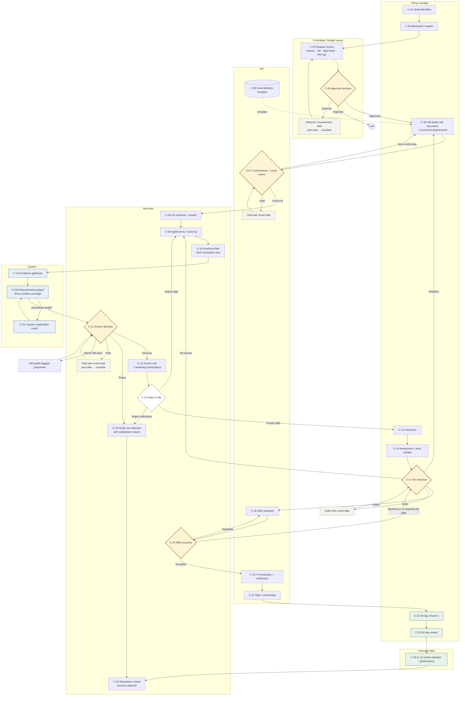
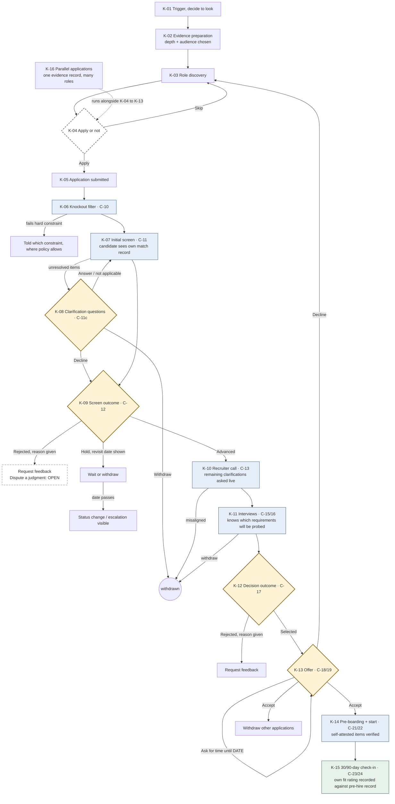

# Hiring Workflow Diagrams (Mermaid source)

Revision 2, 2026-11-08. Node numbers match `09-hiring-workflows-draft.md`. Rendered copy: <https://claude.ai/artifact/AJWsmPtYodKEfbcbBRbieL>, or open `diagrams/workflow-viewer.html` locally for pan and zoom. GitHub renders the blocks below directly; the `.mmd` sources in `diagrams/` are the same text.

Legend: diamond = decision point · dashed grey border = open pending the pilot (C-14, K-04, K-09) · dashed amber = hold/deferred state, dated, escalates when the date passes unreviewed · blue = system or system touchpoint · green = outcome data.

## 1. Company perspective (swimlanes by owner)

## 2. Candidate perspective

